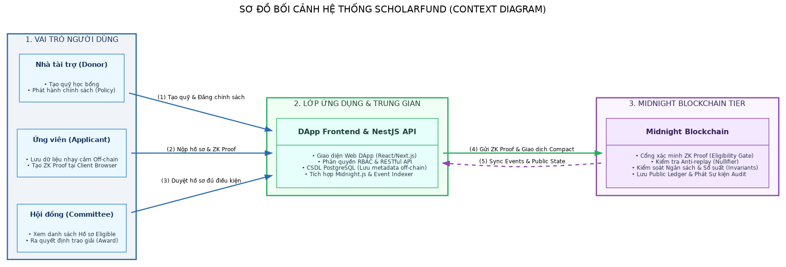

# ScholarFund —  (W1: System Context)

> **Chủ trì Lane C:** Hiếu (Product / UX / DApp / Documentation)  
> **Giai đoạn:** P1 — Bối cảnh hệ thống (System Context & High-Level Scope)  
> **Phiên bản:** W1-Deliverable-Final  

---

## 1. Tổng Quan & Định Vị MVP Dự Án ScholarFund

**ScholarFund** là giải pháp nền tảng cho phép tổ chức và quản lý các quỹ học bổng riêng tư trên nền tảng **Midnight Blockchain**. Dự án giải quyết triệt để sự xung đột giữa tính minh bạch của quy trình xét duyệt và quyền bảo mật thông tin cá nhân nhạy cảm của ứng viên.

* **Bài toán thực tế:** Các quy trình xét duyệt truyền thống yêu cầu ứng viên nộp dữ liệu thô (điểm GPA, báo cáo thu nhập gia đình), gây nguy cơ rò rỉ dữ liệu hoặc giám sát không cần thiết. Ngược lại, blockchain công cộng thông thường biến toàn bộ dữ liệu này thành công khai vĩnh viễn.
* **Giải pháp ZKP & Selective Disclosure:** Ứng viên chạy module **ZK Prover** trực tiếp trên trình duyệt client để tính toán và khởi tạo bằng chứng riêng tư toán học (`EligibilityProof`). Hệ thống chứng minh ứng viên thỏa mãn bộ tiêu chí (ví dụ: $\text{GPA} \ge 3.5$ và $\text{Thu nhập} \le 120.000.000\text{ VNĐ}$) mà **không bao giờ gửi dữ liệu GPA hay Thu nhập thô lên máy chủ backend hay Midnight Ledger**.

---

## 2. Luồng Nghiệp Vụ Cấp Cao (High-Level 4-Step Workflow)

Vòng đời vận hành của ScholarFund được chuẩn hóa qua 4 bước chính:

```
[1. Create Fund & Publish Policy] ➔ [2. Apply & Local ZK Proof] ➔ [3. Verify Eligibility Gate] ➔ [4. Committee Review & Award]
```

1. **Bước 1: Tạo Quỹ & Công Bố Chính Sách (Create Fund & Publish Policy)**
   * **Nhà tài trợ (Donor)** khởi tạo quỹ, thiết lập tổng ngân sách công bố (`publicBudget`), số suất tối đa (`awardCap`) và thời hạn.
   * Hệ thống chuyển đổi bộ tiêu chí thành dạng chuẩn `CanonicalPolicy`, tính toán mã cam kết mật mã `policyCommitment` và phát hành phiên bản bất biến `CriteriaVersion` lên Midnight Blockchain.

2. **Bước 2: Ứng Tuyển & Tạo Bằng Chứng ZK (Apply & Generate Local ZK Proof)**
   * **Ứng viên (Applicant)** tra cứu quỹ, nạp tệp chứng chỉ test off-chain chứa điểm GPA và thu nhập.
   * Module ZK Prover trên trình duyệt client tính toán witness off-chain và tạo `EligibilityProof` gắn chặt với tập bối cảnh `(fundId, criteriaVersion, campaignRound)` kèm mã chống nộp lặp `campaignNullifier`.

3. **Bước 3: Xác Minh Cổng Eligibility & Chống Nộp Lặp (Verify & Anti-Replay)**
   * Ứng viên gửi bằng chứng ZK lên Midnight Smart Contract.
   * Cổng xác minh Compact (`EligibilityGate`) kiểm tra tính đúng đắn của bằng chứng so với `policyCommitment` mà không đọc dữ liệu gốc.
   * Smart contract kiểm tra mã `campaignNullifier` chưa từng tồn tại trên ledger để chống nộp lặp (Anti-replay check), sau đó phát ra sự kiện công khai `ProofAccepted`.

4. **Bước 4: Xét Duyệt & Trao Giải (Committee Review & Award)**
   * **Hội đồng xét duyệt (Committee)** truy vấn danh sách hồ sơ hợp lệ (đã qua cổng ZK), đánh giá và ra quyết định duyệt (`Approve`/`Reject`) kèm mã lý do (`reasonCode`).
   * Smart contract kiểm tra quyền người gọi (`caller/role`), ngân sách còn lại và số suất trước khi chuyển trạng thái giải thưởng sang `AWARDED` và cập nhật các bộ đếm công khai.

---

## 3. Sơ Đồ Bối Cảnh Hệ Thống (Context Diagram 5 Thành Phần)

Hệ thống ScholarFund được trực quan hóa qua sơ đồ bối cảnh gồm 5 thành phần chính thuộc 3 tầng kiến trúc:


---

## 4. Bảng Phân Định Trách Nhiệm 3 Tầng Kiến Trúc (3-Tier Layer Matrix)

Toàn bộ các tác vụ hệ thống được phân định phạm vi trách nhiệm nghiêm ngặt để đảm bảo an toàn dữ liệu:

| Tầng kiến trúc | Thành phần đảm nhiệm | Trách nhiệm chính (Scope) | Ranh giới giới hạn (Out of Scope / Restrictions) |
| :--- | :--- | :--- | :--- |
| **User Roles Layer** | Applicant, Donor, Committee Reviewer, Public Auditor | Đăng nhập phân quyền (RBAC), nhập dữ liệu nghiệp vụ, khởi tạo bằng chứng ZK off-chain trên trình duyệt, ra quyết định xét duyệt. | **Không** gửi GPA/thu nhập thô hay witness bí mật lên server hay blockchain payload. |
| **Application & API Layer** | Web DApp Frontend, NestJS REST API, PostgreSQL DB | Cung cấp giao diện DApp, quản lý phân quyền RBAC, mã hóa metadata off-chain, điều phối qua Midnight.js, sync public events cho Audit UI. | **Không** tự quyết định eligibility bằng cách tin dữ liệu client gửi trực tiếp; DB off-chain không thay thế dữ liệu on-chain. |
| **Midnight Ledger Layer** | Compact Smart Contract, Verifier Circuits, Event Ledger | Lưu trữ public state (`policyCommitment`, `nullifiers`, bộ đếm ngân sách), xác minh ZK Proof, thực thi invariants bảo mật. | **Không** lưu trữ thông tin danh tính thô; không cung cấp API giải mã dữ liệu riêng tư off-chain. |

---

## 5. Bộ Thuật Ngữ Trải Nghiệm Người Dùng (UX Glossary ZKP v1)

Bộ từ điển 6 thuật ngữ ZKP cốt lõi giúp chuẩn hóa ngôn ngữ giao diện cho người dùng DApp:

1. **Client Witness (Dữ liệu bí mật cục bộ):** Điểm GPA và thu nhập thực tế lưu hoàn toàn trong bộ nhớ trình duyệt của ứng viên, không bao giờ gửi ra ngoài.
2. **Eligibility Proof (Bằng chứng riêng tư):** Mã toán học được khởi tạo ở client chứng minh ứng viên đủ điều kiện học bổng mà không lộ chỉ số GPA hay thu nhập.
3. **Policy Commitment (Mã cam kết chính sách):** Chuỗi mã hóa hash bảo chứng rằng nội dung điều kiện học bổng không bị Nhà tài trợ sửa đổi âm thầm sau khi công bố.
4. **Campaign Nullifier (Mã chống nộp lặp):** Mã ngẫu nhiên dùng một lần gắn với kỳ nộp hồ sơ, giúp ngăn ứng viên nộp lại một bằng chứng hoặc nhận giải hai lần.
5. **Selective Disclosure (Tiết lộ có chọn lọc):** Cơ chế xác minh cho phép chỉ xuất ra kết quả đạt/không đạt mà không cần mở rộng toàn bộ hồ sơ gốc.
6. **Canonical Policy (Chính sách chuẩn hóa):** Định dạng dữ liệu chuẩn mực của bộ tiêu chí học bổng trước khi chuyển thành cam kết mật mã.

---
